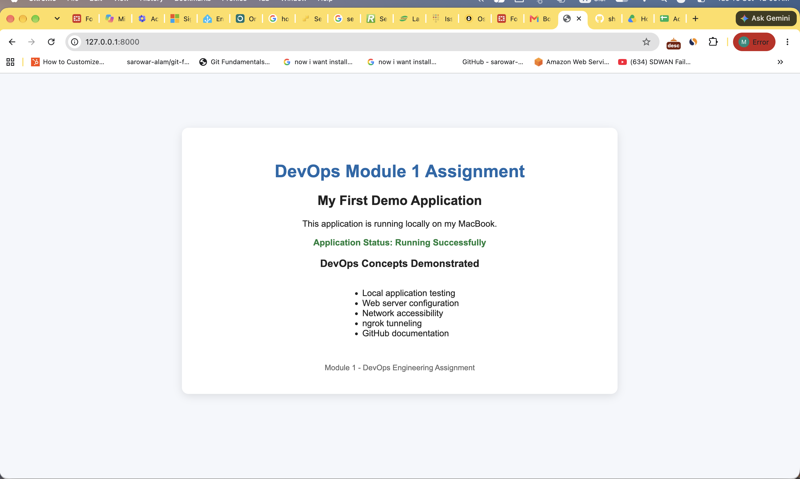
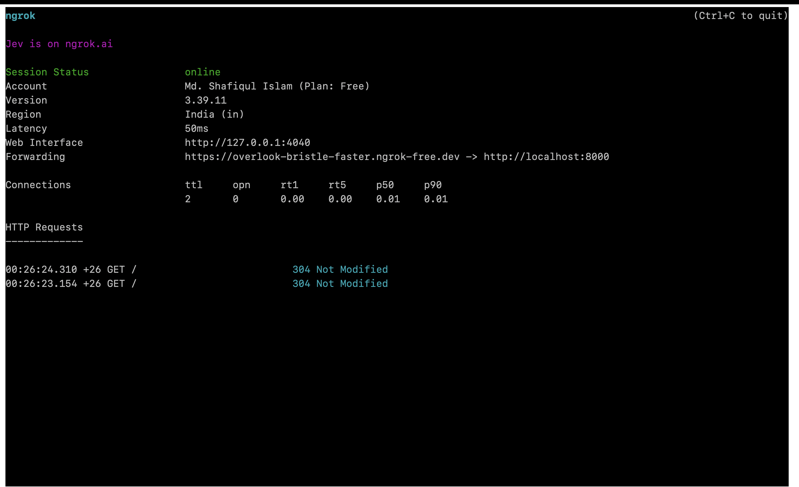
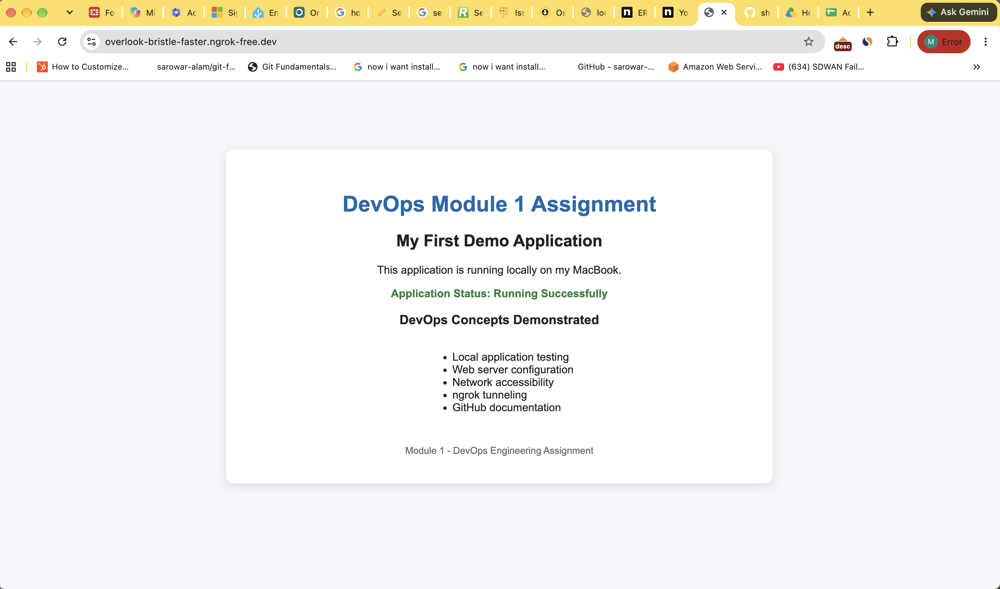

# devops-module-1-assignment
Module 1 DevOps Engineering Assignment

## Part C: Technical / Practical Tasks

### Task 1: Local DevOps Demo Application

**Objective:** Run a simple web application locally and verify that it works.

**Tools Used:**
- macOS
- Python 3
- HTML
- Python HTTP Server

**Application Directory:**
`app/index.html`

**Command Used:**

`python3 -m http.server 8000 --directory app`

**Local URL:**

`http://127.0.0.1:8000`

**Verification:**

The application was tested in a web browser. Successful display of the demo page confirmed that the local web server was serving the application.

**Screenshot:**

**Why is local testing important in DevOps?**

Local testing helps developers verify application behavior before deployment. It allows teams to identify errors early, test configuration changes, and reduce the risk of introducing defects into production environments.

### Task 2: Exposing the Local Application Using ngrok

**Objective:** Make the local demo application accessible through a public HTTPS URL.

**Tool Used:**
ngrok

**Local Application:**

`http://127.0.0.1:8000`

**Command Used:**

`ngrok http 8000`

**Public URL:**

[[NGROK URL](https://overlook-bristle-faster.ngrok-free.dev)

**Verification:**

The generated public URL was opened in a web browser to verify access to the demo application through the ngrok tunnel.

**Screenshot 1: ngrok Tunnel**

**Screenshot 2: Public Application Access**

**Real-World Use Case:**

Developers can use ngrok to share a locally running application with teammates or clients for testing and feedback without deploying it to a public production server.

**Security Consideration:**

A public tunnel exposes a local service to external requests. Sensitive applications should not be exposed without appropriate authentication and access controls. The tunnel should be stopped when it is no longer required.
